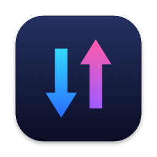
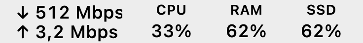
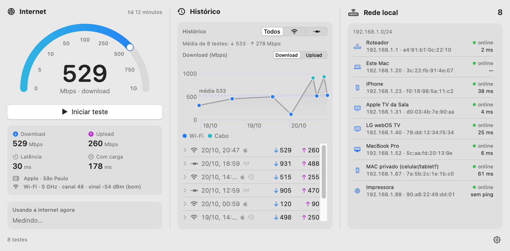
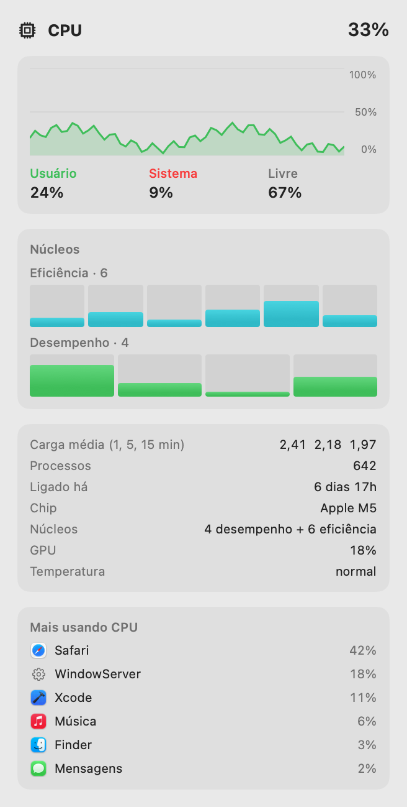
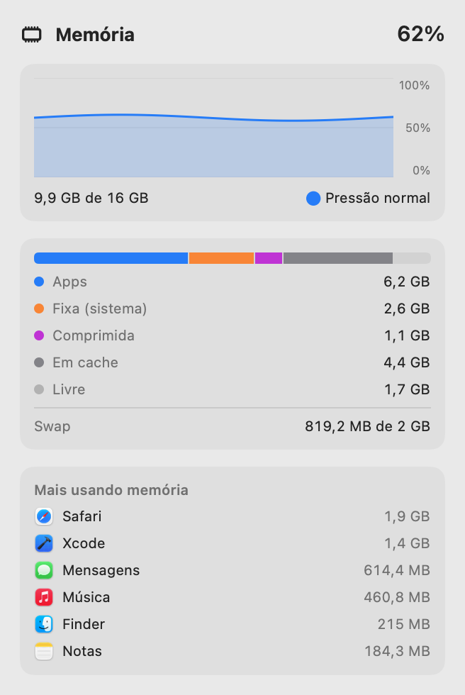
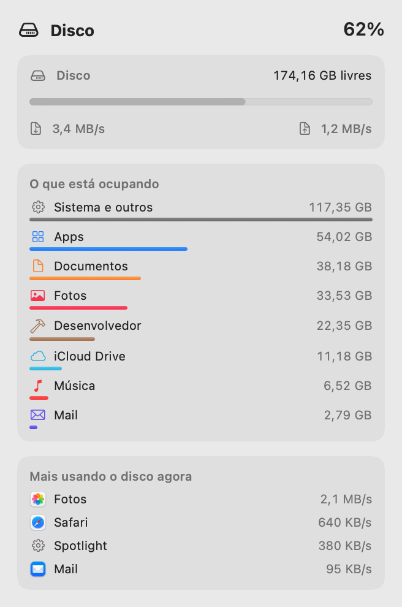

<p align="center">
  
</p>

<h1 align="center">Fluxo</h1>

<p align="center">
  Teste de velocidade, tráfego ao vivo, rede local, CPU, memória e disco na barra de menus do macOS.<br>
  Sem ícone no Dock, sem bibliotecas de terceiros.
</p>

<p align="center">
  <a href="https://github.com/marcosznl/fluxo/releases/latest"><b>⬇︎ Baixar o DMG</b></a>
  &nbsp;·&nbsp; macOS 14 Sonoma ou mais novo &nbsp;·&nbsp; Apple Silicon &nbsp;·&nbsp; 0,8 MB
</p>

<p align="center">
  <picture>
    <source media="(prefers-color-scheme: dark)" srcset="docs/barra-completa-escuro.png">
    
  </picture>
  <br><sub>Tráfego, CPU, RAM e SSD na barra de menus. Cada ícone abre o seu painel.</sub>
</p>

<p align="center">
  <picture>
    <source media="(prefers-color-scheme: dark)" srcset="docs/painel-escuro.png">
    
  </picture>
</p>

<p align="center">
  <picture>
    <source media="(prefers-color-scheme: dark)" srcset="docs/painel-cpu-escuro.png">
    
  </picture>
  &nbsp;
  <picture>
    <source media="(prefers-color-scheme: dark)" srcset="docs/painel-ram-escuro.png">
    
  </picture>
  &nbsp;
  <picture>
    <source media="(prefers-color-scheme: dark)" srcset="docs/painel-ssd-escuro.png">
    
  </picture>
</p>

## Rede

- Na barra de menus, o **tráfego ao vivo** do Mac (↓ download e ↑ upload, atualizado a cada
  segundo). Pela engrenagem dá para trocar por "velocidade do último teste" ou "só o ícone".

- Dois tipos de teste, escolhidos na engrenagem (o padrão é o da Apple):
  - **Apple**: o `networkQuality` da própria Apple, até a rede da Apple (São Paulo).
    Mostra o que você sente no uso real.
  - **Operadora**: até um servidor de teste perto de você, de preferência da sua operadora
    (no caso da Nio, os da V.tal), com 8 conexões em paralelo. Se ele falhar, o app cai
    sozinho para o teste da Apple e avisa.
- Velocímetro em meia-lua (escala 0 · 5 · 10 · 50 · 100 · 250 · 500 · 750 · 1G) que enche
  ao vivo: azul no download, roxo no upload.
- Resultado: download, upload, latência e latência com carga (a latência enquanto a
  conexão está cheia, que mostra se a internet "trava" quando alguém baixa algo pesado),
  com o servidor em nome legível ("Apple · São Paulo", "Vtal · Curitiba").
- Cada teste registra se foi por **Wi-Fi** ou **cabo**. No Wi-Fi, guarda também faixa,
  canal, sinal (dBm), ruído e taxa do link, lidos no início do teste pelo CoreWLAN (sem
  pedir permissão de Localização; por isso o nome da rede não aparece).
- **Usando a internet agora**: com o painel aberto, os 5 apps que mais usam a rede naquele
  momento, lidos do `nettop` (que só roda enquanto o painel está aberto).
- O histórico filtra por conexão, mostra a média da seleção e um gráfico (download ou
  upload) com uma linha só e os pontos coloridos por Wi-Fi ou cabo. Clicar num teste abre
  tudo o que foi guardado dele; dali dá para apagá-lo. "Limpar histórico…" fica na engrenagem.
- O teste pode ser cancelado no meio (botão Cancelar ou Esc).
- Teste automático (a cada 1, 3, 6 ou 12 horas) que se adia sozinho no hotspot do celular,
  no Modo de Poucos Dados e, se você quiser, na bateria. Ele só notifica quando algo foge
  do normal: falha, ou download abaixo da metade do típico para aquela conexão.
- Ajustes na engrenagem: servidor, o que mostrar na barra de menus, teste
  automático, "automático só no carregador", módulos e abrir ao iniciar a sessão.
- **Rede local**: os aparelhos da sua rede, se estão online e o ping até cada um. O Mac
  descobre os aparelhos sozinho (ping em toda a sub-rede e a tabela ARP), e os nomes vêm
  do Bonjour/mDNS (Macs, iPhones, impressoras) e do UPnP (TVs, Chromecast, roteador).
  Aparelhos com "endereço privado" (MAC aleatório), comuns em celulares, aparecem
  marcados assim. A varredura só roda com o painel aberto, a cada 30 s.
- O painel da rede é dividido em colunas (Internet, Histórico e Rede local). Pela
  engrenagem, em **Módulos**, dá para esconder as colunas que você não usa.

## Sistema

Cada um tem o seu ícone na barra de menus, com o percentual ao vivo, e o seu painel:

- **CPU**: gráfico dos últimos 2 minutos, usuário/sistema/livre, uso de cada núcleo
  (separados em eficiência e desempenho no Apple Silicon), carga média, uso da GPU,
  estado térmico e os processos que mais usam CPU.
- **Memória**: gráfico de uso, pressão de memória, quanto é de apps, fixa, comprimida e
  em cache, swap e os processos que mais ocupam memória.
- **Disco**: espaço livre, leitura e escrita ao vivo, o que está ocupando o disco por
  categoria (Apps, Documentos, Fotos, Música, Desenvolvedor…, como em Ajustes do Sistema)
  e os apps que mais estão lendo ou gravando agora.
- Cada painel tem a sua engrenagem: intervalo de atualização (1, 2 ou 5 s), quantos
  processos listar, o que o ícone mostra (percentual ou GB) e se ele aparece na barra.
- Leve: os ícones só se redesenham quando o número muda, e as listas de processos e de
  categorias só são medidas com o painel aberto.

Na primeira vez que o painel do disco abre, o macOS pede para o Fluxo ler as pastas
Documentos, Mesa e Downloads (é assim que ele mede o espaço delas). Mail, Mensagens e
Lixo só entram na conta se o Fluxo tiver "Acesso Total ao Disco"; sem isso, o espaço
delas fica em "Sistema e outros". A rede local pede a permissão de "Rede Local".

## Geral

- Segue o modo claro/escuro do sistema.

Usa só o que vem no macOS (SwiftUI, Charts, CoreWLAN, Network, IOKit, Bonjour, `networkQuality`).
Não há bibliotecas de terceiros. Cada teste consome em torno de 1 GB numa fibra de 500 Mb.

## Instalar

1. Baixe o `.dmg` na [página de releases](https://github.com/marcosznl/fluxo/releases/latest),
   abra e arraste o Fluxo para **Aplicativos**.
2. O app não é notarizado pela Apple, então o macOS bloqueia na primeira vez. No macOS 14,
   clique com o botão direito no Fluxo → **Abrir**. No macOS 15 ou mais novo, tente abrir e
   depois vá em Ajustes do Sistema → Privacidade e Segurança → **Abrir Mesmo Assim**.

## Compilar

Só precisa das Command Line Tools (não precisa do Xcode):

```bash
scripts/build.sh --install
```

Isso gera `dist/Fluxo.app`, copia para `~/Applications` e abre. Os ícones aparecem na
barra de menus. Para sair, use a engrenagem no canto do painel.

Se houver um certificado "Apple Development" no Mac, o script assina com ele. Assim a
assinatura não muda entre builds, e o macOS não pede as permissões de novo a cada build.

## Dados

O histórico fica em `~/Library/Application Support/Fluxo/historico.json`.

## Para desenvolvimento

```bash
swift build
.build/debug/Fluxo --snapshot /tmp/snap   # salva PNGs dos painéis (claro e escuro), com dados de exemplo
.build/debug/Fluxo --rede-local             # varre a rede local e imprime os aparelhos
.build/debug/Fluxo --teste apple          # teste real no terminal, sem gravar no histórico
.build/debug/Fluxo --teste operadora      # idem, até o servidor da operadora
.build/debug/Fluxo --teste apple --cancelar-em 6   # testa o cancelamento
.build/debug/Fluxo --trafego                # imprime o tráfego ao vivo por 5 s
.build/debug/Fluxo --apps                   # imprime os apps que mais usam a rede por 10 s
.build/debug/Fluxo --teste operadora --simular-falha   # confere o plano B (cai para a Apple)
```

Observação: o SwiftUI deste macOS implementa `@State` como macro, que só compila com
o Xcode completo. Por isso o código usa `@StateObject` e `@AppStorage` no lugar.

## Licença

[MIT](LICENSE).
